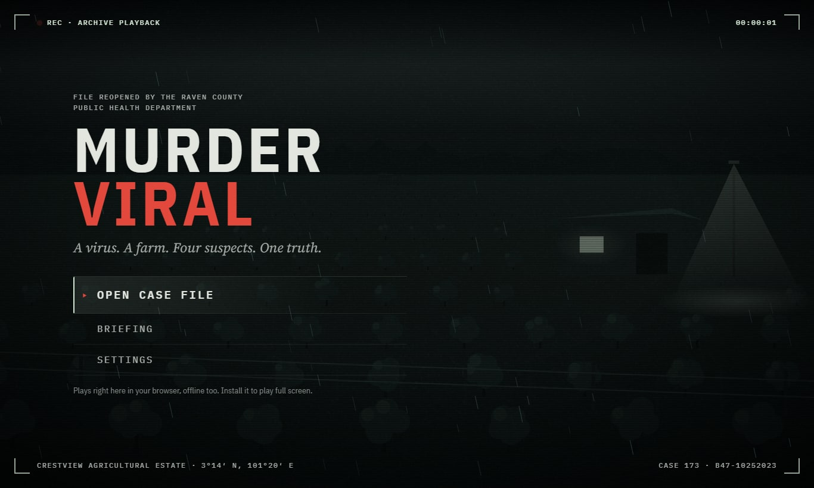
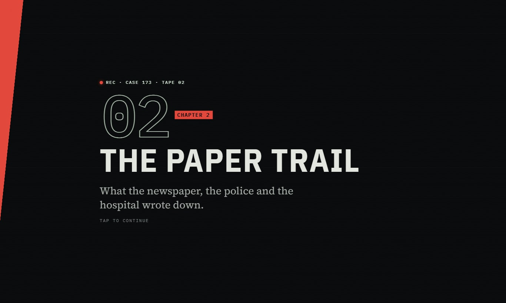
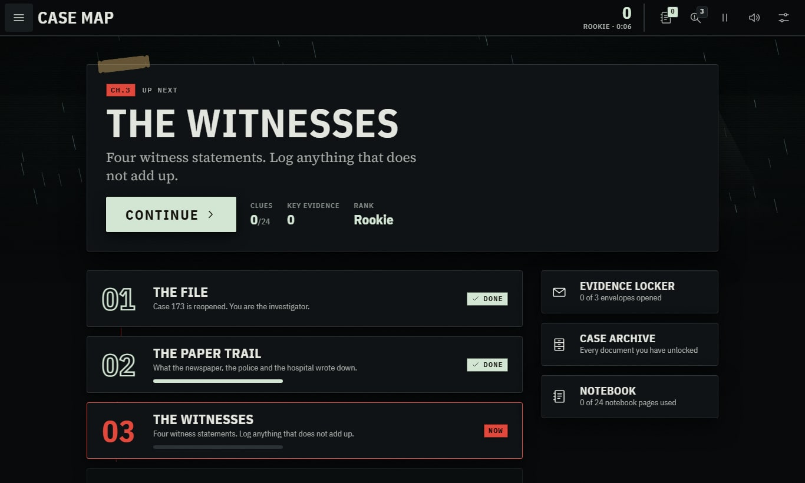
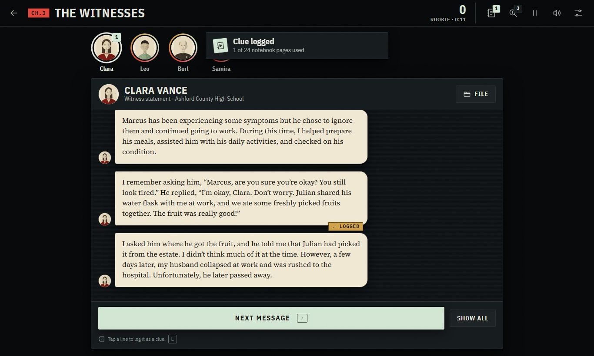
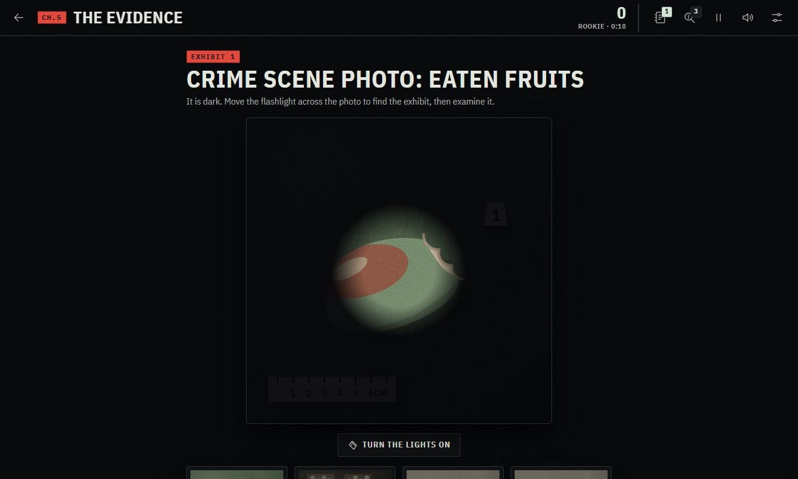
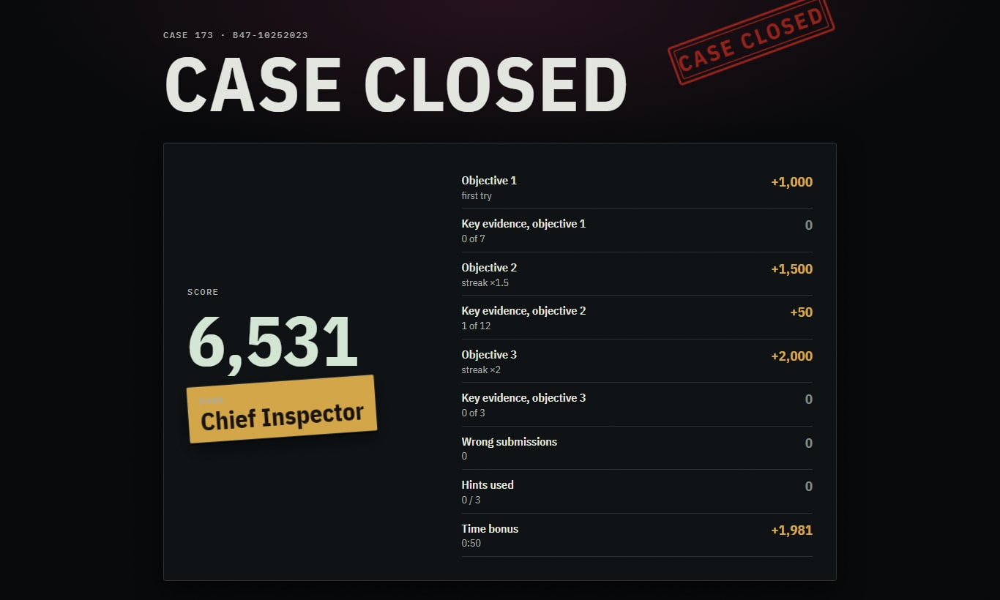

# MURDER VIRAL: Case 173 · Windows

A public health detective game for Windows 10 and 11.

File **B47-10252023** is reopened. Marcus Vance, lead fruit orchard supervisor at Crestview Agricultural Estate,
collapsed at work and died in hospital, and the police closed the case with no charges. You are the investigator.
Read the paper trail, play back every witness and person-of-interest statement, search the evidence photos by
flashlight, and crack three sealed objectives. Each answer is locked in an envelope that only opens once you commit.

Reviewed like archived surveillance footage and a case file, with an original adaptive true-crime score that is
generated live (no audio files), nine chapters, a stopwatch, streaks, ranks and achievements.

**Fully offline.** No account, no ads, no analytics, no network requests.

<table>
  <tr>
    <td align="center"> Title screen</td>
    <td align="center"> Chapter card</td>
  </tr>
  <tr>
    <td align="center"> Case map</td>
    <td align="center"> Interview transcript</td>
  </tr>
  <tr>
    <td align="center"> Evidence search by flashlight</td>
    <td align="center"> Case closed</td>
  </tr>
</table>

## Download
| File | What it is | Size |
|---|---|---|
| **[MurderViral-1.0.0-Setup.exe](https://github.com/astaboyyye/MurderViral-Windows/releases/download/v1.0.0/MurderViral-1.0.0-Setup.exe)** | Installer (recommended): Start menu entry and an uninstaller | 3.2 MB |
| [MurderViral-1.0.0.msi](https://github.com/astaboyyye/MurderViral-Windows/releases/download/v1.0.0/MurderViral-1.0.0.msi) | The same installer as an MSI package, for managed PCs | 3.8 MB |
| [MurderViral-1.0.0-portable.exe](https://github.com/astaboyyye/MurderViral-Windows/releases/download/v1.0.0/MurderViral-1.0.0-portable.exe) | Portable: double-click to play, nothing is installed | 3.4 MB |

All versions are on the [Releases page](https://github.com/astaboyyye/MurderViral-Windows/releases).

- Needs Windows 10 or 11 (64-bit) with Microsoft Edge WebView2, which Windows 11 already has. The installers fetch
  WebView2 if it is missing; the portable exe does not.
- The app is not code-signed, so Windows SmartScreen may warn on the first run: choose **More info**, then **Run anyway**.
- Desktop extras: keyboard controls (arrow keys, **N** notebook, **H** hint, **M** mute, **Esc** back), windowed or
  full screen (**F11**), and Quit to desktop from the title screen.

| File | SHA-256 |
|---|---|
| MurderViral-1.0.0-Setup.exe | `2e950e5ac884c74c2a0bc7ee4e5889e913131d71610b4723810424206e36a3d8` |
| MurderViral-1.0.0.msi | `52e4592ac97217a27b09912f252042885846d41edbec778554eb9f6d044f456e` |
| MurderViral-1.0.0-portable.exe | `04b270925197330f416c8fd89e57ad5439eccf0e73a752eadc49ce8791f07401` |

## Other versions
- **Android**: [MurderViral-Android](https://github.com/astaboyyye/MurderViral-Android) (APK)
- **Web**: play in the browser at [murderviral.astasolutions.my](https://murderviral.astasolutions.my); it installs as an app and works offline

## Credits
Game, art, sound and music are original. Fonts: Source Serif 4, IBM Plex Sans Condensed and IBM Plex Mono
(SIL Open Font License). Animation: GSAP (GreenSock Standard "no charge" license).

© 2026 astaboyyye. All rights reserved.
